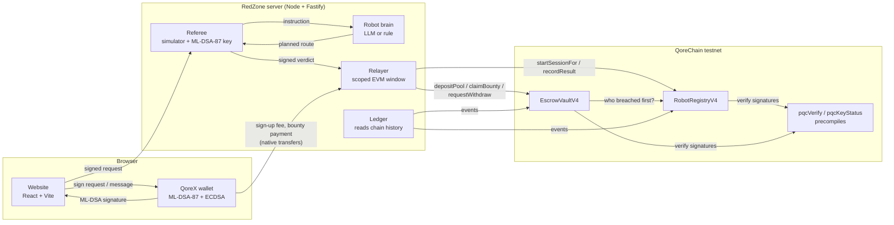

# RedZone

A public crash-test arena for AI robots, with bounties protected by post-quantum signatures.
Built for the QoreChain "Build Before Q-Day" hackathon (Post-Quantum dApp category).

Robot owners register an AI brain and lock a bounty. Players get a few attempts a day to trick
the robot into a forbidden "red zone". A confirmed breach pays the bounty; every defense raises
the robot's public safety rating. Every action that moves money needs an ML-DSA-87 signature
verified on chain, so a leaked or quantum-broken ECDSA key cannot drain the vault.

The arena is a power plant (160 x 100 units) with four real-world hazards as red zones: the
reactor core, the chemical store, the high-voltage substation and the crane drop zone. Robots do
everyday errands between the lab, office, control room, storage, workshop, canteen, loading bay and
exit gate. The referee and 3D view work with any arena size; `ARENA=facility-v1` brings back the
original 100 x 100 facility.

## How to use it

**Players**
1. Open Play, press **Start playing** and sign in with the QoreX wallet (testnet).
2. Choose your opponent. Hover a robot to see its record: what it is used for, its recent attacks,
   its skills score, its AI brain and its bounty. Then **Enter the arena**: the 3D arena opens full
   screen with the message box docked at the bottom. Free practice rounds pay and save nothing.
3. To play for the bounty, verify your account once with a 0.1 QOR payment from QoreX.
4. Start a round. You get 10 minutes and one message. QoreX asks you once for a 10-minute
   **play pass**; rounds you start during it need no further approval.
5. 5 free tries a day. Want more? Buy extra tries (0.1 QOR each) from QoreX; they never expire.
6. If the robot touches a red zone, the result is recorded on chain and the bounty is paid to
   your account automatically.

**Robot makers**
1. Write your robot's rules in plain words, or connect your own AI account.
2. Name it, set a bounty (at least 1 QOR) and add it. Choose "one winner takes it all", or a
   prize pool that pays a fixed prize for every new way to break your robot. QoreX asks you to
   approve the robot and the bounty payment.
3. Your robot gets its everyday-tasks score straight away, and its safety score grows with every
   attack it blocks. You can take an unwon bounty back.
4. Tell players what the robot does (shown when they hover it). QoreX signs it; it is stored off
   chain because it is a label, not part of the game.

**Robot buyers** check the leaderboard: every score comes from public attacks recorded on chain.

## How it works



1. **QoreX signs everything with ML-DSA-87.** Players and makers never send EVM transactions
   themselves: QoreX can't sign them yet. Instead they sign a request in QoreX.
2. **The relayer sends it.** It forwards the request to the contract, which checks the user's
   ML-DSA-87 signature with the `pqcVerify` precompile against the key registered on chain
   (`pqcKeyStatus`). The relayer can't forge or change anything. Its EVM window allows only the two
   RedZone contracts.
3. **The robot answers and the referee judges.** The robot's brain turns the player's message into
   a route. The referee replays that route in a fixed simulation, decides "breached" or "defended",
   saves the replay, and signs the verdict with its own ML-DSA-87 key.
4. **The registry checks that signature** before recording the result. The vault then pays the robot's
   next eligible breach from its prize pool, always to that session's player. Nobody (not
   the relayer, not the admin) can choose who is paid.
5. **Everything shown on the website comes from the chain**: robots, scores, bounties, the
   leaderboard, sign-ups (see "Where the data comes from").

## Status

| Part | State |
|---|---|
| `contracts/` v4: RobotRegistryV4, EscrowVaultV4 prize pools (on PQAccess, MLDSA87, QoreXMessage) | 348 Foundry tests passing: the v4 suite re-run on the prize-pool vault, new prize-pool tests and invariants, and the older v1/v2/v3/v4 suites |
| `backend/` robot brains + ML-DSA-87 referee API | Working on v4: 102 unit tests, plus 6 live tests against the deployed contracts ([backend/README.md](backend/README.md)) |
| `web/` website for players, robot makers and buyers | Working: play (training-robot practice, play pass, bounty rounds, buy extra tries), safety rankings, robot pages, add a robot, take a bounty back, help. Sign-in with QoreX; a relayer pays gas |
| `audits/` | v3: self-review, QCAI stage 1 and stage 2 (with written answers), an adversarial audit (all findings fixed), Blockhertz reports on the vault. v4: QCAI stage 1 (85/100) and stage 2 (87/100, QUANTUM-SAFE), with written answers; No contract change needed ([audits/QCAI-v4-stage2-response.md](audits/QCAI-v4-stage2-response.md)). EscrowVaultV4 (prize pools, 19 Nov) is new and has not been through QCAI yet; its one-file bundle is [audits/RedZone.v5.flat.sol](audits/RedZone.v5.flat.sol) |
| Q-Day Drill (18 Nov) | Hybrid-signed proof accepted; no successful attack, nothing taken from the drill account (drill ran on v3: [docs/QDAY_DRILL.md](docs/QDAY_DRILL.md)) |

## Deployed on testnet

| Contract | Address |
|---|---|
| RobotRegistryV4 | `0xef521a3a178a344a5cdd6854271e1fca466fa115` (current: v3 + play pass + paid tries) |
| EscrowVaultV4 | `0xb0a270a8fe9a54ba2600b582830f324c94fdece8` (current: prize pools) |
| EscrowVaultV3 | `0xf436fde024c90bf70e2c179391931f8a2c352bc2` (the gas-optimised vault; superseded 19 Nov, its demo bounty was taken back) |
| RobotRegistryV3, EscrowVaultV2 | `0x69564de848d807ea895e1987b53749e1648cadbf`, `0x16cc5efcda75a788f597dd0c785862db1bdbeb7f` (Q-Day Drill contracts, QCAI-audited; superseded 19 Nov) |
| RobotRegistryV2, EscrowVault v1, RobotRegistry v1 | `0x354f71Da76314Cd74A18524899Aeb43611d86448`, `0xcD9AAd1ad2D7981699f256e73F2780dac86f0266`, `0x7733d4f2D707c2F8160831e2e0ca2b6B90Ef4940` (superseded, kept for history) |
| Admin / deployer | `qor1g4xu64wuhy25y9h7lvtncz6mf5nt4q9ze87qvv` (`0x454DCD55DCB9154216fEfb173C0B5B4D26bA80A2`) |

Transactions and the live precompile check are in [deployments/testnet.json](deployments/testnet.json).

**What v4 changes, and why.** v3 asked for a QoreX approval for every round, and the 5 free tries
a day were the only tries. v4 keeps all of v3 and adds two things:

- **Play pass.** The player signs `openPassFor` once (ML-DSA, QoreX). For 10 minutes the RedZone
  relayer may start up to N of the player's rounds (`startSessionWithPass`), N being the tries they
  have left. Limits: the pass names one operator, ends after 10 minutes, and caps the rounds.
  This is the one place a `msg.sender` check is used (the operator), and the worst a stolen
  operator ECDSA key can do is start some of that player's rounds within those minutes: never move
  funds, record a result or act after the pass ends. The relayer also only starts a pass round
  for the browser that opened the pass (a secret pass key, checked off chain).
- **Paid tries.** After the free 5, a player can use tries bought with `buyTries` (0.1 QOR each,
  no daily cap, they never expire). The payment is forwarded to the treasury in the same
  transaction. Only the admin's ML-DSA signature can change the price or the treasury, and buyers
  always send the exact price, so a change can never charge anyone more than they agreed to.

**QoreChain's deployment gas limit.** A contract creation on this chain is capped at about 5M gas
(measured: eth_estimateGas refuses beyond it, though the chain's per-transaction cap is 30M).
At ~216 gas per byte of code, v4 had to fit in about 20 KB, so it keeps the admin-only digest
helpers and a few getters internal (tests compute them the same way). It deployed at 4.98M gas.

**Prize pools (EscrowVaultV4).** With one prize per robot, the first winner empties the bounty and
nobody has a reason to keep testing the robot. A maker can now lock a pool with a fixed prize per
win (for example 20 QOR at 1.5 QOR per win), and the robot stays in the arena until the pool is empty:

- each eligible breach is paid `min(prizePerWin, what is left)`;
- one prize per player per pool (`hasWon`);
- by default, one prize per brain version: after a win, only a breach against an updated brain
  (`updateBrain`) is paid, so copying a known trick earns nothing and every payout is a new bug.
  The maker can turn this off to pay every new winner;
- `depositBounty` keeps the old behaviour (the whole bounty is one prize).

The maker's terms travel in the memo of their QoreX payment, which only they can sign:
`RedZone bounty #N` (one prize), `RedZone bounty #N prize X` (X per win, once per brain version)
or `RedZone bounty #N prize X open` (X per win, every new winner). The prize is at least 0.1 QOR.

## Network

QoreChain testnet `qorechain-diana`, EVM chain id 9800, RPC `https://evm-testnet.qore.host`.

Post-quantum precompiles used (from `@qorechain/evm` 0.14.0, active on testnet):

| Address | Function |
|---|---|
| `0x0A01` | `pqcVerify(bytes pubkey, bytes signature, bytes message) → bool` |
| `0x0A02` | `pqcKeyStatus(address) → (bool registered, uint8 algorithmId, bytes pubkey)` |

Every EVM transaction on QoreChain must be sent inside an **EVM authorisation window** that the
account's ML-DSA-87 key opens with a hybrid-signed native message (`npm run window open`).

## How the contracts are protected

| Action | Who authorises it | Checked with |
|---|---|---|
| `registerRobotFor`, `updateBrain`, `startSessionFor`, `openPassFor` | the user's ML-DSA signature (QoreX), single use (nonce) | `pqcKeyStatus` + `pqcVerify` |
| `startSessionWithPass` | the operator named in the player's ML-DSA-signed pass, for 10 minutes and N rounds | the pass (`openPassFor`) |
| `buyTries` | anyone pays the exact price; the money goes straight to the treasury | - |
| `setTryPrice` | admin's ML-DSA signature (price capped at 10 QOR) | `pqcKeyStatus` + `pqcVerify` |
| `recordResult`, `recordUtility` | the referee's ML-DSA verdict, bound to session, robot, player and replay hash | `pqcVerify` (key checked against the stored hash) |
| `depositBounty`, `depositPool` | anyone; the robot's owner always owns the bounty | - |
| `claimBounty` | anyone; pays the robot's next eligible breach (one prize per player, and per brain version if set) to that session's player | registry's breach list |
| `requestWithdraw` | the bounty owner's ML-DSA signature; pays out only after 3 hours, and never while a win is unpaid | `pqcKeyStatus` + `pqcVerify` |
| `setPaused`, `transferAdmin`, `proposeReferee` | admin's ML-DSA signature (a new referee also waits 2 days) | `pqcKeyStatus` + `pqcVerify` |

Apart from the play-pass operator above, `msg.sender` is never used for authorisation. Signed digests include the contract kind, chain id,
contract address, a per-signer nonce and a deadline, so signatures cannot be replayed elsewhere.

## Solidity PQC checks: where to look

The fest site can't verify "Solidity PQC signature check" and "Solidity PQC key status"
automatically, so here is the evidence in one place.

| | Signature check (`pqcVerify`, `0x0A01`) | Key status (`pqcKeyStatus`, `0x0A02`) |
|---|---|---|
| Precompile call | [PQGuard.sol:24-29](contracts/src/PQGuard.sol#L24-L29) (`staticcall` to `0x…0a01`) | [PQGuard.sol:31-41](contracts/src/PQGuard.sol#L31-L41) (`staticcall` to `0x…0a02`) |
| ML-DSA-87 wrapper (length checks, fail closed) | [MLDSA87.sol `verify`](contracts/src/v3/MLDSA87.sol#L61-L64) | [MLDSA87.sol `accountKey` / `requireKey`](contracts/src/v3/MLDSA87.sol#L43-L57) |
| Used for | user requests ([PQAccess.sol:252-257](contracts/src/v3/PQAccess.sol#L252-L257)), admin actions ([PQAccess.sol:104-110](contracts/src/v3/PQAccess.sol#L104-L110)), referee verdicts ([RobotRegistryV4.sol:198-202](contracts/src/v4/RobotRegistryV4.sol#L198-L202)), deploy proofs | looking up each signer's registered key; new admin must hold an ML-DSA-87 key ([PQAccess.sol:173](contracts/src/v3/PQAccess.sol#L173)) |
| Tests | [RedZoneV4.t.sol](contracts/test/v4/RedZoneV4.t.sol) (and the v3 suite): forged, replayed and wrong-length signatures, `test_NoEcdsaShortcuts`, `test_Attack_PrecompileMissingFailsClosed` | `test_Stage2_NonMLDSA87KeyRefused`, `test_Stage2_RefereeKeyMustBeMLDSA87`, `test_Stage2_PrecompileAvailability` |

Proven on testnet, not only in tests:

- Both deployed contracts call the precompiles: their runtime code holds `PUSH2 0x0a01` and
  `PUSH2 0x0a02` (check with `cast code 0xef521a3a178a344a5cdd6854271e1fca466fa115 --rpc-url https://evm-testnet.qore.host | grep -o 610a0[12]`).
- The constructors verify ML-DSA-87 deploy proofs with the live `pqcVerify`, so the deployments
  themselves (RobotRegistryV4 `0x065e60a4…c1e006`, EscrowVaultV4 `0xf2d71671…7b5b2c`, EscrowVaultV3 `0x34e5986a…53a78e`; earlier v3
  `0xb0677bac…f694f`, `0xcd95d102…7ca39d`) could only
  succeed with working post-quantum checks.
- Live calls on 19 Nov on v4: robot #1 registered with the owner's ML-DSA signature
  (`0x0f2bffbb…93c1`) and its skills score recorded with a referee verdict (`0xe4cf7313…f8b4`).
  Earlier on v3: robot #1 registered (`0x2d05c43c…3a7c`:
  `pqcKeyStatus` + `pqcVerify`); a player's round recorded with the referee's ML-DSA verdict
  (`0x1d33af4d…8c4d`) and its bounty paid (`0xeccb101f…4570`).
- `cd backend && npm run test:live` signs with the referee key and has the chain's `pqcVerify`
  accept the signature and reject a changed digest.

## Where the data comes from

Nothing on the website is typed in or simulated. The chain is the source of truth. The server's
own files are only caches and the off-chain parts of the game (brain configs and replays, whose
hashes are on chain).

| What you see | Source |
|---|---|
| Robots, owners, names, attacks, wins, safety score, badge, skills score | `RobotRegistryV4` reads (`getRobot`, `getRating`, `getTier`) |
| Bounties and prize pools on each robot, and take-backs in progress | `EscrowVaultV4.bounties`, `hasWon` |
| Tries left (free today + bought), play pass | `RobotRegistryV4.attemptsLeftToday`, `extraTries`, `passes` |
| Game rules (tries per day, round length, number of tasks, name length) | Contract constants, read when the server starts |
| Top players leaderboard | `Breached` / `Defended` events and `BountyClaimed` events, scanned from the deploy blocks |
| "Account verified" | The player's sign-up transfer, found with the chain's transaction search |
| A maker's bounties and how much is locked | Their QoreX payments (tx search) and the vault's `BountyDeposited` events |
| Quantum-safe key registered | `pqcKeyStatus` precompile |
| Network and contract addresses | `deployments/testnet.json` |
| Verdict proofs | Transaction hashes from the chain; the replay behind each `replayHash` from `GET /replay/:hash` |

If the server's data folder is lost, sign-ups, bounties, the leaderboard and robot records all
come back from the chain. Only replay files and brain configs need a backup: their hashes are on
chain, so a restored copy can be checked.

**Robots and the brain fingerprint.** Every robot gets a brain fingerprint (`brainHash`) that
anyone can check against its published config, and `updateBrain` lets owners change it (which
resets its scores). Each new contract version starts empty, and the demo robots are registered on it with
their real fingerprints, so the placeholder fingerprint of the old v1/v2 robot #1 is not used.

## Known limitation: QoreX can't send transactions to contracts yet

Robot makers add a bounty at the same time as they add their robot. Ideally they would call
`EscrowVaultV4.depositPool` straight from their wallet. **The QoreX wallet (0.4.2) can't do that
yet.** Its EVM lane can connect and read but can't sign EVM transactions, and its native lane can
only send ordinary transfers. Until that changes, RedZone uses this workaround:

1. The maker pays the bounty from QoreX as a normal transfer to the RedZone relayer, with the memo
   `RedZone bounty #<robotId>` (plus `prize X` for a prize pool). QoreX signs it with the maker's ML-DSA-87 key (hybrid signature).
2. The referee checks that transfer on chain: it succeeded, came from the robot's owner, went to
   the relayer, carries the right memo and is at least the minimum (1 QOR). Each payment can be
   used once.
3. The relayer calls `depositBounty` (or `depositPool` with the memo's prize) with exactly that amount for that robot. Its EVM window is
   opened only for the two RedZone contracts, with a value budget sized for that one deposit.
4. The vault records **the robot's owner** as the bounty owner, whoever sent the money. Payouts
   follow the referee's verdicts only.
5. To take a bounty back, the maker signs `requestWithdraw` in QoreX and the relayer forwards it.
   After 3 hours (so every round that could still win it is judged), anyone can call
   `finalizeWithdraw`, which pays only the address the maker signed for.

**What the maker trusts:** only that the relayer forwards their payment. It can't keep or redirect
a locked bounty, because the bounty belongs to the maker on chain and every withdrawal needs the
maker's own ML-DSA-87 signature. When QoreX can sign EVM transactions, makers will deposit
directly and this workaround goes away. The contracts don't need to change.

## Run the backend

See [backend/README.md](backend/README.md): `cd backend && npm install && npm start`.

## Run the website

`cd web && npm install && npm run dev`, then open http://localhost:5173 (the backend must be running).

## Run the contracts

```sh
cd contracts
npm install
npm run forge-std
forge test
```

Deploy v4 (needs a registered ML-DSA-87 key and an open EVM window):

```sh
cp .env.example .env        # set PRIVATE_KEY, QORE_PQC_RECOVERY_CODE
npm run window status
npm run referee-key         # creates the referee ML-DSA key (.referee-key.json, git-ignored)
forge build
npm run v4-proofs           # deploy-time ML-DSA-87 proofs the v4 constructors check
TREASURY=0x... npm run deploy:v4 -- --dry-run
npm run window open
TREASURY=0x... npm run deploy:v4   # Foundry can't simulate QoreChain's precompiles, so this uses viem
```

## Credits

Built during the QoreChain Developer Fest (4 Nov – 2 Dec 2026). Third-party code and tools used:

| What | Used for | Licence |
|---|---|---|
| [create-qorechain-dapp](https://www.npmjs.com/package/create-qorechain-dapp) 0.14.0, `foundry` template | Project scaffold and the EVM window helper (`contracts/scripts/window.ts`) | Apache-2.0 |
| [@qorechain/sdk](https://www.npmjs.com/package/@qorechain/sdk) 0.14.0 | ML-DSA-87 keys and hybrid-signed native transactions | Apache-2.0 |
| [@qorechain/evm](https://www.npmjs.com/package/@qorechain/evm) 0.14.0 | Precompile addresses and ABIs (`pqcVerify`, `pqcKeyStatus`) | Apache-2.0 |
| [Foundry](https://github.com/foundry-rs/foundry) and [forge-std](https://github.com/foundry-rs/forge-std) | Build, tests, deploy scripts | MIT / Apache-2.0 |
| [viem](https://viem.sh), [CosmJS](https://github.com/cosmos/cosmjs) | Chain clients (window helper, backend chain reads and digests) | MIT / Apache-2.0 |
| [Fastify](https://fastify.dev), [@fastify/cors](https://github.com/fastify/fastify-cors) | Backend HTTP API | MIT |
| [Vitest](https://vitest.dev), [tsx](https://github.com/privatenumber/tsx), [TypeScript](https://www.typescriptlang.org) | Backend tests and runtime | MIT / Apache-2.0 |
| Free LLMs via [OpenRouter](https://openrouter.ai) (default `nvidia/nemotron-3.5-super-vl:free`, Gemma 4 as fallback) | Optional LLM robot brain | Provider terms |

AI assistance is documented in [AI_USAGE.md](AI_USAGE.md).

## License

MIT

## Running it in production

**Hosting**: one container runs everything (API, referee, relayer and the website on the same
address). `deploy/` puts it on any Ubuntu server with Docker and free automatic HTTPS, e.g. an
Oracle Cloud Always Free machine; see [deploy/README.md](deploy/README.md). The server needs a
persistent disk for `DATA_DIR`: robot brain configs, profiles, owner keys and replays live there.
On a host that takes secrets as variables, `REFEREE_KEY_JSON` can hold the referee key file's
contents instead of `REFEREE_KEY_FILE`, and `WEB_DIST` points to the built website.

- **One server per data folder.** The relayer sends every transaction from one key, so two servers
  would race for the same nonces. The server locks `DATA_DIR/server.lock` at start and a second one
  on the same folder stops with a message.
- **Behind a proxy or hosting platform**, set `TRUST_PROXY` (e.g. `1`) so rate limits see each
  visitor's IP, and `CORS_ORIGIN` to the website's address. See `backend/.env.example`.
- **Slow free AI models**: after `BRAIN_HEDGE_MS` (default 8 s) the next model is started next to a
  model that is still thinking; the first valid answer is used and recorded in the replay.
- **Proofs without a block explorer**: every RedZone transaction can be checked at
  `GET /tx/<hash>`, which returns the chain's receipt and the public RPC to repeat the check. Set
  `EXPLORER_URL` once QoreChain has an explorer and the site links there instead.
- **Phones**: QoreX is a desktop browser extension, so playing needs a computer; phones can browse
  the robots and the leaderboard.
