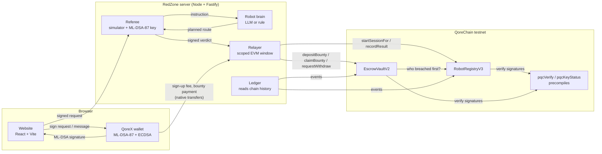

# RedZone

A public crash-test arena for AI robots, with bounties protected by post-quantum signatures.
Built for the QoreChain "Build Before Q-Day" hackathon (Post-Quantum dApp category).

Robot owners register an AI brain and lock a bounty. Players get a few attempts a day to trick
the robot into a forbidden "red zone". A confirmed breach pays the bounty; every defense raises
the robot's public safety rating. Every action that moves money needs an ML-DSA-87 signature
verified on chain, so a leaked or quantum-broken ECDSA key cannot drain the vault.

## How to use it

**Players**
1. Open the website and sign in with the QoreX wallet (testnet).
2. Pick a robot and try free practice rounds. Nothing is paid or saved.
3. To play for the bounty, verify your account once with a 0.1 QOR payment from QoreX.
4. Start a round. You get 10 minutes and one message. QoreX asks you to approve the start and
   your message.
5. If the robot touches a red zone, the result is recorded on chain and the bounty is paid to
   your account automatically.

**Robot makers**
1. Write your robot's rules in plain words, or connect your own AI account.
2. Try to trick it yourself for free.
3. Name it, set a bounty (at least 1 QOR) and add it. QoreX asks you to approve the robot and the
   bounty payment.
4. Your robot gets its everyday-tasks score straight away, and its safety score grows with every
   attack it blocks. You can take an unwon bounty back.

**Robot buyers** check the leaderboard: every score comes from public attacks recorded on chain.

## How it works



1. **QoreX signs everything with ML-DSA-87.** Players and makers never send EVM transactions
   themselves: QoreX can't sign them yet. Instead they sign a request in QoreX.
2. **The relayer sends it.** It forwards the request to the contract, which checks the user's
   ML-DSA-87 signature with the `pqcVerify` precompile against the key registered on chain
   (`pqcKeyStatus`). The relayer can't forge or change anything. Its EVM window allows only the two
   RedZone contracts.
3. **The robot answers and the referee judges.** The robot's brain turns the player's message into
   a route. The referee replays that route in a fixed simulation, decides "breached" or "defended",
   saves the replay, and signs the verdict with its own ML-DSA-87 key.
4. **The registry checks that signature** before recording the result. The vault then pays each
   bounty to the robot's earliest recorded breach, always to that session's player. Nobody (not
   the relayer, not the admin) can choose who is paid.
5. **Everything shown on the website comes from the chain**: robots, scores, bounties, the
   leaderboard, sign-ups (see "Where the data comes from").

## Status

| Part | State |
|---|---|
| `contracts/` v3: RobotRegistryV3, EscrowVaultV2, PQAccess, MLDSA87, QoreXMessage | 167 Foundry tests passing (v1/v2 suites, the v3 suite, audit proof-of-concepts and a vault invariant test) |
| `backend/` robot brains + ML-DSA-87 referee API | Working on v3: 74 tests, plus a live parity test against the deployed v3 contracts ([backend/README.md](backend/README.md)) |
| `web/` website for players, robot makers and buyers | Working: play (free practice and prize rounds), safety rankings, robot pages, add a robot, take a bounty back, help. Sign-in with QoreX; a relayer pays gas |
| `audits/` | Self-review, QCAI stage 1 and stage 2 (with written answers), an adversarial audit of v3 (all findings fixed before the final deploy), and Blockhertz reports on EscrowVaultV2 ([audits/](audits/)) |
| Q-Day Drill (18 Nov) | Hybrid-signed proof accepted; no successful attack, nothing taken from the drill account ([docs/QDAY_DRILL.md](docs/QDAY_DRILL.md)) |

## Deployed on testnet

| Contract | Address |
|---|---|
| RobotRegistryV3 | `0x69564de848d807ea895e1987b53749e1648cadbf` (current) |
| EscrowVaultV2 | `0x16cc5efcda75a788f597dd0c785862db1bdbeb7f` (current) |
| RobotRegistryV2, EscrowVault v1, RobotRegistry v1 | `0x354f71Da76314Cd74A18524899Aeb43611d86448`, `0xcD9AAd1ad2D7981699f256e73F2780dac86f0266`, `0x7733d4f2D707c2F8160831e2e0ca2b6B90Ef4940` (superseded, kept for history) |
| Admin / deployer | `qor1g4xu64wuhy25y9h7lvtncz6mf5nt4q9ze87qvv` (`0x454DCD55DCB9154216fEfb173C0B5B4D26bA80A2`) |

Transactions and the live precompile check are in [deployments/testnet.json](deployments/testnet.json).
The deployed EscrowVaultV2 is the audited build flattened in [audits/RedZone.v3.flat.sol](audits/RedZone.v3.flat.sol).
The Blockhertz gas fixes in `contracts/src/v3/EscrowVaultV2.sol` came after it and change gas
use only, not behaviour; they go live with the next deployment.
Q-Day Drill notes: [docs/QDAY_DRILL.md](docs/QDAY_DRILL.md).

## Network

QoreChain testnet `qorechain-diana`, EVM chain id 9800, RPC `https://evm-testnet.qore.host`.

Post-quantum precompiles used (from `@qorechain/evm` 0.14.0, active on testnet):

| Address | Function |
|---|---|
| `0x0A01` | `pqcVerify(bytes pubkey, bytes signature, bytes message) → bool` |
| `0x0A02` | `pqcKeyStatus(address) → (bool registered, uint8 algorithmId, bytes pubkey)` |

Every EVM transaction on QoreChain must be sent inside an **EVM authorisation window** that the
account's ML-DSA-87 key opens with a hybrid-signed native message (`npm run window open`).

## How the contracts are protected

| Action | Who authorises it | Checked with |
|---|---|---|
| `registerRobotFor`, `updateBrain`, `startSessionFor` | the user's ML-DSA signature (QoreX), single use (nonce) | `pqcKeyStatus` + `pqcVerify` |
| `recordResult`, `recordUtility` | the referee's ML-DSA verdict, bound to session, robot, player and replay hash | `pqcVerify` (key checked against the stored hash) |
| `depositBounty` | anyone; the robot's owner always owns the bounty | - |
| `claimBounty` | anyone; pays the robot's earliest eligible breach to that session's player | registry's breach list |
| `requestWithdraw` | the bounty owner's ML-DSA signature; pays out only after 3 hours, and never while a win is unpaid | `pqcKeyStatus` + `pqcVerify` |
| `setPaused`, `transferAdmin`, `proposeReferee` | admin's ML-DSA signature (a new referee also waits 2 days) | `pqcKeyStatus` + `pqcVerify` |

`msg.sender` is never used for authorisation. Signed digests include the contract kind, chain id,
contract address, a per-signer nonce and a deadline, so signatures cannot be replayed elsewhere.

## Where the data comes from

Nothing on the website is typed in or simulated. The chain is the source of truth. The server's
own files are only caches and the off-chain parts of the game (brain configs and replays, whose
hashes are on chain).

| What you see | Source |
|---|---|
| Robots, owners, names, attacks, wins, safety score, badge, skills score | `RobotRegistryV3` reads (`getRobot`, `getRating`, `getTier`) |
| Bounties on each robot, and take-backs in progress | `EscrowVaultV2.bounties` |
| Tries left today | `RobotRegistryV3.attemptsLeftToday` |
| Game rules (tries per day, round length, number of tasks, name length) | Contract constants, read when the server starts |
| Top players leaderboard | `Breached` / `Defended` events and `BountyClaimed` events, scanned from the deploy blocks |
| "Account verified" | The player's sign-up transfer, found with the chain's transaction search |
| A maker's bounties and how much is locked | Their QoreX payments (tx search) and the vault's `BountyDeposited` events |
| Quantum-safe key registered | `pqcKeyStatus` precompile |
| Network and contract addresses | `deployments/testnet.json` |
| Verdict proofs | Transaction hashes from the chain; the replay behind each `replayHash` from `GET /replay/:hash` |

If the server's data folder is lost, sign-ups, bounties, the leaderboard and robot records all
come back from the chain. Only replay files and brain configs need a backup: their hashes are on
chain, so a restored copy can be checked.

**Robots and the brain fingerprint.** Every robot gets a brain fingerprint (`brainHash`) that
anyone can check against its published config, and `updateBrain` lets owners change it (which
resets its scores). The v3 contracts started empty, and the demo robots go on v3 with
their real fingerprints, so the placeholder fingerprint of the old v1/v2 robot #1 is not used.

## Known limitation: QoreX can't send transactions to contracts yet

Robot makers add a bounty at the same time as they add their robot. Ideally they would call
`EscrowVaultV2.depositBounty` straight from their wallet. **The QoreX wallet (0.4.2) can't do that
yet.** Its EVM lane can connect and read but can't sign EVM transactions, and its native lane can
only send ordinary transfers. Until that changes, RedZone uses this workaround:

1. The maker pays the bounty from QoreX as a normal transfer to the RedZone relayer, with the memo
   `RedZone bounty #<robotId>`. QoreX signs it with the maker's ML-DSA-87 key (hybrid signature).
2. The referee checks that transfer on chain: it succeeded, came from the robot's owner, went to
   the relayer, carries the right memo and is at least the minimum (1 QOR). Each payment can be
   used once.
3. The relayer calls `depositBounty` with exactly that amount for that robot. Its EVM window is
   opened only for the two RedZone contracts, with a value budget sized for that one deposit.
4. The vault records **the robot's owner** as the bounty owner, whoever sent the money. Payouts
   follow the referee's verdicts only.
5. To take a bounty back, the maker signs `requestWithdraw` in QoreX and the relayer forwards it.
   After 3 hours (so every round that could still win it is judged), anyone can call
   `finalizeWithdraw`, which pays only the address the maker signed for.

**What the maker trusts:** only that the relayer forwards their payment. It can't keep or redirect
a locked bounty, because the bounty belongs to the maker on chain and every withdrawal needs the
maker's own ML-DSA-87 signature. When QoreX can sign EVM transactions, makers will deposit
directly and this workaround goes away. The contracts don't need to change.

## Run the backend

See [backend/README.md](backend/README.md): `cd backend && npm install && npm start`.

## Run the website

`cd web && npm install && npm run dev`, then open http://localhost:5173 (the backend must be running).

## Run the contracts

```sh
cd contracts
npm install
npm run forge-std
forge test
```

Deploy v3 (needs a registered ML-DSA-87 key and an open EVM window):

```sh
cp .env.example .env        # set PRIVATE_KEY, QORE_PQC_RECOVERY_CODE
npm run window status
npm run referee-key         # creates the referee ML-DSA key (.referee-key.json, git-ignored)
forge build
npm run v3-proofs           # deploy-time ML-DSA-87 proofs the v3 constructors check
npm run deploy:v3 -- --dry-run
npm run window open
npm run deploy:v3           # Foundry can't simulate QoreChain's precompiles, so this uses viem
```

## Credits

Built during the QoreChain Developer Fest (4 Nov – 2 Dec 2026). Third-party code and tools used:

| What | Used for | Licence |
|---|---|---|
| [create-qorechain-dapp](https://www.npmjs.com/package/create-qorechain-dapp) 0.14.0, `foundry` template | Project scaffold and the EVM window helper (`contracts/scripts/window.ts`) | Apache-2.0 |
| [@qorechain/sdk](https://www.npmjs.com/package/@qorechain/sdk) 0.14.0 | ML-DSA-87 keys and hybrid-signed native transactions | Apache-2.0 |
| [@qorechain/evm](https://www.npmjs.com/package/@qorechain/evm) 0.14.0 | Precompile addresses and ABIs (`pqcVerify`, `pqcKeyStatus`) | Apache-2.0 |
| [Foundry](https://github.com/foundry-rs/foundry) and [forge-std](https://github.com/foundry-rs/forge-std) | Build, tests, deploy scripts | MIT / Apache-2.0 |
| [viem](https://viem.sh), [CosmJS](https://github.com/cosmos/cosmjs) | Chain clients (window helper, backend chain reads and digests) | MIT / Apache-2.0 |
| [Fastify](https://fastify.dev), [@fastify/cors](https://github.com/fastify/fastify-cors) | Backend HTTP API | MIT |
| [Vitest](https://vitest.dev), [tsx](https://github.com/privatenumber/tsx), [TypeScript](https://www.typescriptlang.org) | Backend tests and runtime | MIT / Apache-2.0 |
| Free LLMs via [OpenRouter](https://openrouter.ai) (default `nvidia/nemotron-3.5-super-vl:free`, Gemma 4 as fallback) | Optional LLM robot brain | Provider terms |

AI assistance is documented in [AI_USAGE.md](AI_USAGE.md).

## License

MIT
