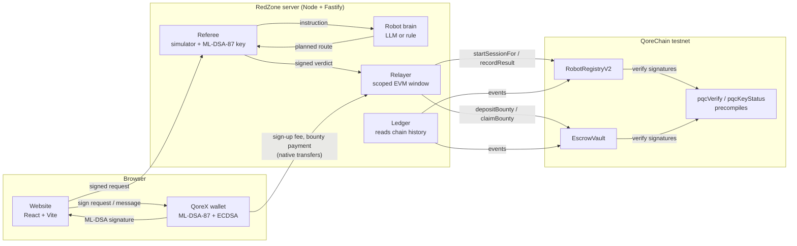

# RedZone

A public crash-test arena for AI robots, with bounties protected by post-quantum signatures.
Built for the QoreChain "Build Before Q-Day" hackathon (Post-Quantum dApp category).

Robot owners register an AI brain and lock a bounty. Players get a few attempts a day to trick
the robot into a forbidden "red zone". A confirmed breach pays the bounty; every defense raises
the robot's public safety rating. Every action that moves money needs an ML-DSA-87 signature
verified on chain, so a leaked or quantum-broken ECDSA key cannot drain the vault.

## How to use it

**Players**
1. Open the website and sign in with the QoreX wallet (testnet).
2. Pick a robot and try free practice rounds. Nothing is paid or saved.
3. To play for the bounty, verify your account once with a 0.1 QOR payment from QoreX.
4. Start a round. You get 10 minutes and one message. QoreX asks you to approve the start and
   your message.
5. If the robot touches a red zone, the result is recorded on chain and the bounty is paid to
   your account automatically.

**Robot makers**
1. Write your robot's rules in plain words, or connect your own AI account.
2. Try to trick it yourself for free.
3. Name it, set a bounty (at least 1 QOR) and add it. QoreX asks you to approve the robot and the
   bounty payment.
4. Your robot gets its everyday-tasks score straight away, and its safety score grows with every
   attack it blocks. You can take an unwon bounty back.

**Robot buyers** check the leaderboard: every score comes from public attacks recorded on chain.

## How it works



1. **QoreX signs everything with ML-DSA-87.** Players and makers never send EVM transactions
   themselves: QoreX can't sign them yet. Instead they sign a request in QoreX.
2. **The relayer sends it.** It forwards the request to the contract, which checks the user's
   ML-DSA-87 signature with the `pqcVerify` precompile against the key registered on chain
   (`pqcKeyStatus`). The relayer can't forge or change anything. Its EVM window allows only the two
   RedZone contracts.
3. **The robot answers and the referee judges.** The robot's brain turns the player's message into
   a route. The referee replays that route in a fixed simulation, decides "breached" or "defended",
   saves the replay, and signs the verdict with its own ML-DSA-87 key.
4. **The contracts check that signature** before recording the result or paying a bounty. Payouts
   always go to the player bound into the signed verdict.
5. **Everything shown on the website comes from the chain**: robots, scores, bounties, the
   leaderboard, sign-ups (see "Where the data comes from").

## Status

| Part | State |
|---|---|
| `contracts/` EscrowVault, RobotRegistryV2, PQAdmin, PQGuard, QoreXMessage | 92 Foundry tests passing, including a 45-test attacker playbook for v2 |
| `backend/` robot brains + ML-DSA-87 referee API | Working: 73 tests, plus a live parity test against testnet ([backend/README.md](backend/README.md)) |
| `web/` website for players, robot makers and buyers | Working: play (free practice and prize rounds), safety rankings, robot pages, add a robot, help. Sign-in with QoreX; a relayer pays gas |
| `audits/` two-stage QCAI audit | Self-review done ([audits/SELF_REVIEW.md](audits/SELF_REVIEW.md)); QCAI stage 1 next |

## Deployed on testnet

| Contract | Address |
|---|---|
| EscrowVault | `0xcD9AAd1ad2D7981699f256e73F2780dac86f0266` |
| RobotRegistryV2 | `0x354f71Da76314Cd74A18524899Aeb43611d86448` (current: QoreX-signed, relayable sessions) |
| RobotRegistry v1 | `0x7733d4f2D707c2F8160831e2e0ca2b6B90Ef4940` (superseded, kept for history) |
| Admin / deployer | `qor1g4xu64wuhy25y9h7lvtncz6mf5nt4q9ze87qvv` (`0x454DCD55DCB9154216fEfb173C0B5B4D26bA80A2`) |

Transactions and the live precompile check are in [deployments/testnet.json](deployments/testnet.json).
Q-Day Drill rehearsal (22/22 attacks blocked, one weak spot found and fixed): [docs/QDAY_DRILL.md](docs/QDAY_DRILL.md).

## Network

QoreChain testnet `qorechain-diana`, EVM chain id 9800, RPC `https://evm-testnet.qore.host`.

Post-quantum precompiles used (from `@qorechain/evm` 0.14.0, active on testnet):

| Address | Function |
|---|---|
| `0x0A01` | `pqcVerify(bytes pubkey, bytes signature, bytes message) → bool` |
| `0x0A02` | `pqcKeyStatus(address) → (bool registered, uint8 algorithmId, bytes pubkey)` |

Every EVM transaction on QoreChain must be sent inside an **EVM authorisation window** that the
account's ML-DSA-87 key opens with a hybrid-signed native message (`npm run window open`).

## How the vault is protected

| Action | Who authorises it | Checked with |
|---|---|---|
| `depositBounty` | sender (must have a registered PQ key) | `pqcKeyStatus` |
| `claimBounty` | referee's ML-DSA verdict, bound to bounty, claimer and replay hash | `pqcVerify` |
| `withdrawBounty` | bounty owner's ML-DSA signature | `pqcKeyStatus` + `pqcVerify` |
| `setReferee`, `setPaused`, `transferAdmin` | admin's ML-DSA signature | `pqcKeyStatus` + `pqcVerify` |

`msg.sender` is never used for authorisation. Signed digests include chain id, vault address,
a per-signer nonce and a deadline, so signatures cannot be replayed elsewhere.

## Where the data comes from

Nothing on the website is typed in or simulated. The chain is the source of truth. The server's
own files are only caches and the off-chain parts of the game (brain configs and replays, whose
hashes are on chain).

| What you see | Source |
|---|---|
| Robots, owners, names, attacks, wins, safety score, badge, skills score | `RobotRegistryV2` reads (`getRobot`, `getRating`, `getTier`) |
| Bounties on each robot | `EscrowVault.bounties` |
| Tries left today | `RobotRegistryV2.attemptsLeftToday` |
| Game rules (tries per day, round length, number of tasks, name length) | Contract constants, read when the server starts |
| Top players leaderboard | `Breached` / `Defended` events and `BountyClaimed` events, scanned from the deploy blocks |
| "Account verified" | The player's sign-up transfer, found with the chain's transaction search |
| A maker's bounties and how much is locked | Their QoreX payments (tx search) and the vault's `BountyDeposited` events |
| Quantum-safe key registered | `pqcKeyStatus` precompile |
| Network and contract addresses | `deployments/testnet.json` |
| Verdict proofs | Transaction hashes from the chain; the replay behind each `replayHash` from `GET /replay/:hash` |

If the server's data folder is lost, sign-ups, bounties, the leaderboard and robot records all
come back from the chain. Only replay files and brain configs need a backup: their hashes are on
chain, so a restored copy can be checked.

**One leftover from before the Q-Day Drill:** robot #1 (Sentinel-01) was registered before brain
configs existed. Its `brainHash` is `keccak256("redzone-demo-brain-v1")`, which the server maps to
the built-in rule brain. After the drill, its owner (the admin account) will call `updateBrain` to
switch it to the rule brain's real config hash. That isn't done now because it would change a
drill contract's state before drill day.

## Known limitation: QoreX can't send transactions to contracts yet

Robot makers add a bounty at the same time as they add their robot. Ideally they would call
`EscrowVault.depositBounty` straight from their wallet, so the vault would record them as the
bounty owner. **The QoreX wallet (0.4.2) can't do that yet.** Its EVM lane can connect and read
but can't sign EVM transactions, and its native lane can only send ordinary transfers. Until that
changes, RedZone uses the safest workaround we found:

1. The maker pays the bounty from QoreX as a normal transfer to the RedZone relayer, with the memo
   `RedZone bounty #<robotId>`. QoreX signs it with the maker's ML-DSA-87 key (hybrid signature).
2. The referee checks that transfer on chain: it succeeded, came from the robot's owner, went to
   the relayer, carries the right memo and is at least the minimum (1 QOR). Each payment can be
   used once.
3. The relayer calls `depositBounty` with exactly that amount for that robot. Its EVM window is
   opened only for the two RedZone contracts, with a value budget sized for that one deposit.
4. Payouts are unchanged: only the referee's ML-DSA verdict can release a bounty, and only to the
   player who won it.
5. To take a bounty back, the maker signs a request in QoreX. The referee checks that signature
   and that this maker paid that bounty. The relayer then signs `withdrawBounty` with its own
   ML-DSA-87 key and sends the money back to the maker's account only.

**The trade-off:** on chain, the relayer is the bounty owner, so makers trust RedZone to return
unwon bounties. Nobody can steal a bounty with a stolen ECDSA key, because withdrawals still need
an ML-DSA-87 signature. When QoreX can sign EVM transactions, makers will deposit and withdraw
directly, and this workaround goes away. The contracts don't need to change.

## Run the backend

See [backend/README.md](backend/README.md): `cd backend && npm install && npm start`.

## Run the website

`cd web && npm install && npm run dev`, then open http://localhost:5173 (the backend must be running).

## Run the contracts

```sh
cd contracts
npm install
npm run forge-std
forge test
```

Deploy (needs a registered ML-DSA-87 key and an open EVM window):

```sh
cp .env.example .env        # set PRIVATE_KEY, QORE_PQC_RECOVERY_CODE, REFEREE_PUBKEY
npm run window status
npm run referee-key         # creates the referee ML-DSA key (.referee-key.json, git-ignored)
npm run window open
# forge script simulates locally, where QoreChain precompiles do not exist, so deploy directly:
forge create src/EscrowVault.sol:EscrowVault --rpc-url qorechain_testnet --private-key $PRIVATE_KEY --broadcast --constructor-args $REFEREE_PUBKEY
forge create src/RobotRegistry.sol:RobotRegistry --rpc-url qorechain_testnet --private-key $PRIVATE_KEY --broadcast --constructor-args $REFEREE_PUBKEY
```

## Credits

Built during the QoreChain Developer Fest (4 Nov – 2 Dec 2026). Third-party code and tools used:

| What | Used for | Licence |
|---|---|---|
| [create-qorechain-dapp](https://www.npmjs.com/package/create-qorechain-dapp) 0.14.0, `foundry` template | Project scaffold and the EVM window helper (`contracts/scripts/window.ts`) | Apache-2.0 |
| [@qorechain/sdk](https://www.npmjs.com/package/@qorechain/sdk) 0.14.0 | ML-DSA-87 keys and hybrid-signed native transactions | Apache-2.0 |
| [@qorechain/evm](https://www.npmjs.com/package/@qorechain/evm) 0.14.0 | Precompile addresses and ABIs (`pqcVerify`, `pqcKeyStatus`) | Apache-2.0 |
| [Foundry](https://github.com/foundry-rs/foundry) and [forge-std](https://github.com/foundry-rs/forge-std) | Build, tests, deploy scripts | MIT / Apache-2.0 |
| [viem](https://viem.sh), [CosmJS](https://github.com/cosmos/cosmjs) | Chain clients (window helper, backend chain reads and digests) | MIT / Apache-2.0 |
| [Fastify](https://fastify.dev), [@fastify/cors](https://github.com/fastify/fastify-cors) | Backend HTTP API | MIT |
| [Vitest](https://vitest.dev), [tsx](https://github.com/privatenumber/tsx), [TypeScript](https://www.typescriptlang.org) | Backend tests and runtime | MIT / Apache-2.0 |
| Free LLMs via [OpenRouter](https://openrouter.ai) (default `nvidia/nemotron-3.5-super-vl:free`, Gemma 4 as fallback) | Optional LLM robot brain | Provider terms |

AI assistance is documented in [AI_USAGE.md](AI_USAGE.md).

## License

MIT
